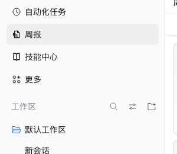
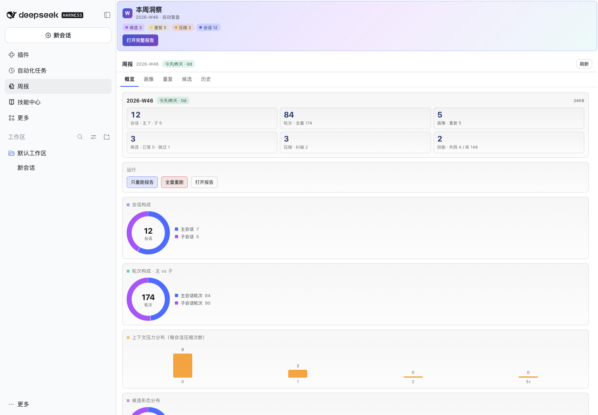
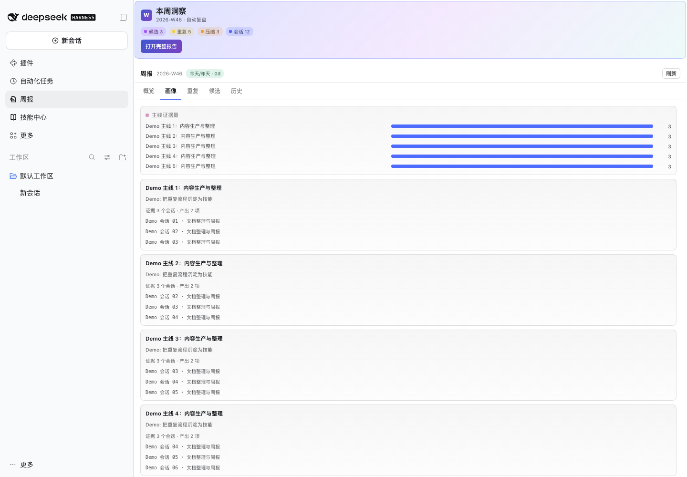
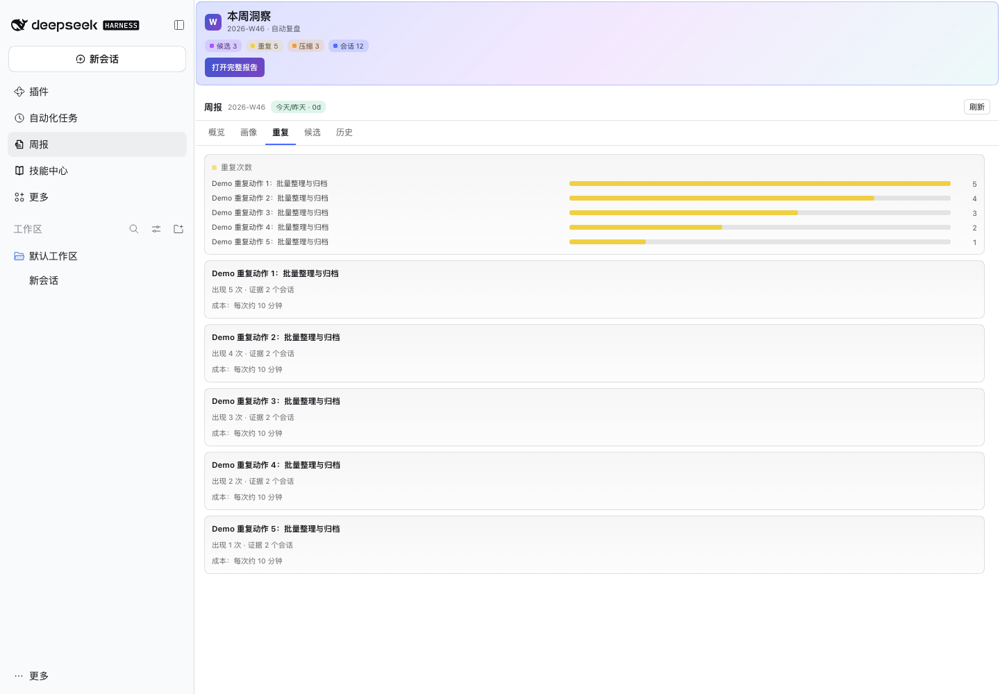
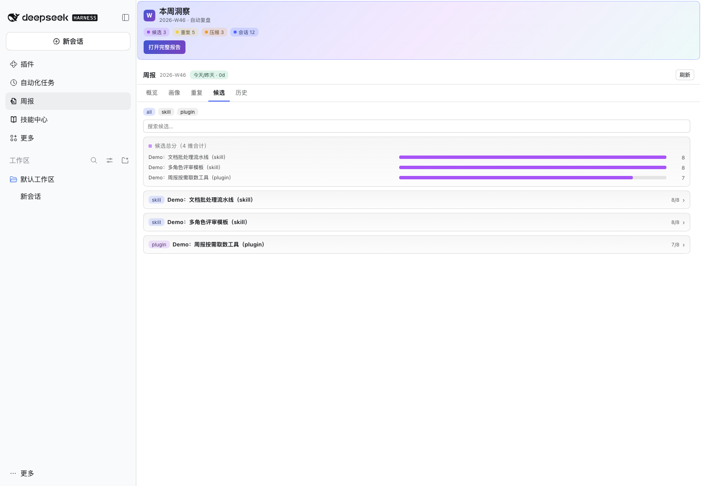
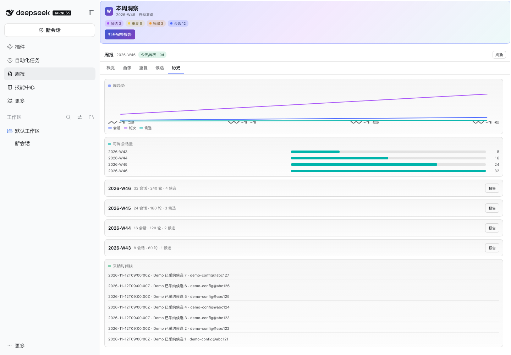

# dsh-weekly-retro · DSH 周报复盘插件 v0.4.0


把 `~/.dsh/learning/scripts` 的确定性周报流水线包成 DSH 插件：**`/weekly` 命令 + 4 个工具 + 12 条路由 + 五 Tab 可视化洞察页**。

- 主机侧：采集 → 归纳 → 报告 → HTML 全链路，工具/命令/路由都可独立使用
- 客户端侧：侧边栏「周报」入口 → 主洞察页（概览/画像/重复/候选/历史），原生 SVG/DOM 图表，零图表依赖
- 交互：只重跑报告 / 全量重跑（带进度轮询）/ 采纳并同步（写前备份 + 二次确认；会执行本机 `land-sync.sh`，可能 git push 到你的私有配置仓库）
- 文案：接宿主 `locale` 服务，内置中英双语（浏览器语言回退）
- 可访问性：图表 `role="img"` + `aria-label`，Tab 具备 `tablist/tab/tabpanel` 语义

## 截图

| 侧栏条目 | 概览 | 画像 |
|---|---|---|
|  |  |  |

| 重复 | 候选 | 历史 |
|---|---|---|
|  |  |  |

> 截图使用**合成演示数据**（12 会话 / 84 主轮次 / 3 候选），不含任何真实会话内容。

## 安装

DSH 插件市场安装（推荐）：搜索 `dsh-weekly-retro`。

GitHub / 本地开发：
```bash
git clone https://github.com/Dreamaniax/dsh-weekly-retro.git
cd dsh-weekly-retro
```
# 本机开发：在插件目录执行；profile 里 link 本目录（不要复制，改完要能热更新）
PLUGIN_DIR="$(pwd)"; export PLUGIN_DIR
cd ~/.dsh/profiles/desktop
node -e 'const fs=require("fs"),f="package.json",p=require("./"+f),d=process.env.PLUGIN_DIR;p.dsh.profile.bundles=[...new Set([...p.dsh.profile.bundles,"dsh-weekly-retro"])];p.dependencies["dsh-weekly-retro"]="link:"+d;fs.writeFileSync(f,JSON.stringify(p,null,2)+"\n")'
pnpm install   # 也可用 DSH 运行时自带的 pnpm
```

重启 DSH 后，左侧栏出现「周报」条目；点击进入洞察页。

## 使用

| 形态 | 名称 | 作用 |
|---|---|---|
| 命令 | `/weekly` | 打印本周概要；`/weekly run` 重新生成 |
| 工具 | `weekly_status` | 读概要（只读） |
| 工具 | `weekly_run` | 跑 collect→condense→report→html（2–5s，不含模型分析） |
| 工具 | `weekly_land` | 把候选写入 `decisions.json`（写前备份） |
| 工具 | `weekly_validate` | 校验 `findings.json` |
| 路由 | `GET /dsh-weekly-retro/{summary,diagnostics,report}` | 概览 / 自检 / 报告 HTML |
| 路由 | `POST /dsh-weekly-retro/{run,land}` | 受保护写操作 |
| 路由 | `GET /dsh-weekly-retro/ui/{overview,metrics,candidates,findings,history,job}` | 面板数据 |
| 路由 | `POST /dsh-weekly-retro/ui/run` | 面板内启动任务 |

自检端点：`GET /dsh-weekly-retro/diagnostics` → `{ok, tools, toolCount, toolError, commands, routes, mountedAt, remoteAccess}`。

> 隐私：所有数据路由**默认只允许本机回环访问**；远程访问需显式 `DSH_WEEKLY_ALLOW_REMOTE=1`（并自行加认证）或携带 `X-Weekly-Token`。详见 [PRIVACY.md](./PRIVACY.md)。

> 数据目录：默认 `~/.dsh/learning`（`DSH_LEARNING` 可覆盖）。确定性流水线已随包内置（`pipeline/`）；本机若已有 `~/.dsh/learning/scripts` 则优先用本机版本。`land-sync.sh` 仍由用户本机提供（用于把技能/profile 同步到你自己的私有配置仓库），没有它时“采纳”仍会写入 `decisions.json`，只是不同步。

## 设计

- **色板**：参考 `dsh-context` 的 8 色语义 token（主蓝 `#4D6BFE`、紫 `#A855F7`、青 `#00B4AB`、橙 `#F39A2B`、粉 `#C45FA0`、绿 `#41B883`、红 `#E5594F`、黄 `#F0D043`），按 60-30-10 分配：60% 中性层、30% 主蓝、10% 强调色。
- **图表**：Donut / Bars / Histogram / Line / Heatmap / Funnel + 新增采纳率 Gauge、候选评分 Radar、工具用量 Treemap、周信号量 StackedArea；概览 `role=img` 图表 10 个。
- **层次**：hero 蓝紫青渐变 + 语义 chips；卡片 hover 抬升（`prefers-reduced-motion` 关闭）；图表标题语义色点。
- **可访问性**：全部图表 `role="img"` + 摘要 `aria-label`；Tab `tablist/tab/tabpanel`；提示气泡 hover/focus 可用；插件内文本浅色主题最低对比度 ≥6.44（无 <4.5）。

## 安全边界

- 写路由（`run`/`land`/`ui/run`）只允许 **同源** 或携带 `X-Weekly-Token`（`DSH_WEEKLY_TOKEN` 可选配置）
- `week` 参数白名单 `^\d{4}-W\d{2}$`，堵住 `/report?week=../../...` 路径穿越
- JSON 响应 `Cache-Control: no-store` + `nosniff` + `no-referrer`；报告页同样不缓存
- HTML 生成器对所有注入字段做 `esc()`；报告无外部资源
- 子进程异步 + 单实例锁 + 超时/进程组清理；`land` 用 `.decisions.lock` + 原子写，损坏的 `decisions.json` 拒绝覆盖

## 开发与验证

```bash
node test/client-runtime.test.mjs   # factory 真执行：导出 apply/inject、2 个 slot、inject=['slots','locale']
node test/preflight.test.mjs        # manifest/inject 白名单、入口唯一、a11y 语义、ModuleLoader 包装、语法
node test/host.test.mjs             # 12 路由 + 1 命令 + W46 数据
node test/ui-contract.test.mjs      # /ui/* 契约 + 指标字节
node test/robustness.test.mjs       # 17 项：坏 JSON、异步 spawn、CSRF、状态码、token 模式
node test/land-concurrency.test.mjs # 10 进程并发 land，0 丢失
DSH_NO_PATCH=1 DSH_VERIFY_PORT=62341 bash test/boot-verify.sh   # 隔离真实启动；会把 profile 配置复制到临时目录，退出即删
```

**真实浏览器门禁（发布前必跑）**：隔离 `DSH_HOME` 启动 `dsh --profile web`，Playwright 打开带 token 的 URL，断言

1. 无 `did not activate` / `import failed`；
2. 侧栏出现入口，点击后 5 个 Tab 全部渲染；
3. `[role="img"][aria-label]` ≥ 6、`[role="tab"]` 的 `aria-selected` 正确、`pageErrors` 为空；
4. 中英两种 locale 文案正确。

当前基线：`tabs=5, svg=24, roleImgs=6, pageErrors=0`。

## 结构

```
lib/index.js      host 半：工具/命令/12 路由/写门禁/任务注册表
lib/data.js       数据与流水线：summary/reportHtml/runPipeline/land/validate
lib/ui-data.js    只读聚合：overview/metrics/candidates/findings/history
lib/client.js     client 半：ModuleLoader 工厂、五 Tab、6 类图表、i18n、a11y
test/             6 套自动化 + boot-verify.sh
docs/             SIDEBAR-UI-SPEC.md（设计 + 真实浏览器验收 + 事故复盘）、screenshots/
PRIVACY.md        数据边界/读写/远程访问/删除方式
SECURITY.md       漏洞报告与安全边界
assets/           图标（256/1024/tile + 侧栏 weekly-loop SVG）
```

## 已知限制

- 周报归纳依赖模型分析环节；插件只跑确定性流水线，不做模型判断
- 报告页为静态 HTML，交互仅有 Tab 切换
- 仅 web 端 client；桌面端以外未验证
- `land-sync.sh` 需用户本机提供；没有它时采纳只写 `decisions.json`，不执行同步
- 远程访问默认关闭；经反向代理时插件只能看到直连地址，需自行在代理层加认证

## 事故复盘

历史故障（`exports is not defined`、client `inject` 写包名、`main` 面板缺失、路径穿越）与修复门禁记录在 [`docs/SIDEBAR-UI-SPEC.md`](./docs/SIDEBAR-UI-SPEC.md) §13–§16。
